# UML Class Diagram

Bu diyagram `src/RestaurantOrders` altındaki sınıflarla aynı adları kullanır. Görünürlük işaretleri: `+` public, `-` private, `#` protected. Yıldız (`*`) soyut metodu gösterir.

Çokluklar:

- Bir siparişin satır sayısı `0..*` olabilir. Yeni sipariş boş açılır. `Preparing` durumuna geçmek için en az bir satır gerekir.
- Her sipariş tam olarak bir müşteriye aittir. Bir müşterinin sıfır veya daha çok siparişi olabilir.
- Her satır tam olarak bir menü ürününe bağlanır. Aynı ürün birçok satırda kullanılabilir.
- `Restaurant` menüyü, müşterileri ve siparişleri listeler halinde tutar. Bu ilişki aggregation olarak gösterilir.
- `OrderLine` nesneleri siparişin parçasıdır. Bu ilişki composition olarak gösterilir.

`FindMenuItem`, `FindCustomer`, `FindOrder` ve `FindLine` bulunamazsa null döner. Özelliklerin set erişimi private'dır; dışarıdan değişim metotlarla yapılır.

```mermaid
classDiagram
    class IPrintable {
        <<interface>>
        +GetDisplayText() string
    }

    class MenuItem {
        <<abstract>>
        +string Id
        +string Name
        +decimal Price
        #MenuItem(string id, string name, decimal price)
        +GetTaxRate()* decimal
        +GetCategory()* string
        +GetPriceWithTax() decimal
        +GetDisplayText() string
        +ChangePrice(decimal newPrice) void
        -FormatMoney(decimal amount) string
    }

    class Food {
        +bool IsVegetarian
        +Food(string id, string name, decimal price, bool isVegetarian)
        +GetTaxRate() decimal
        +GetCategory() string
        +GetDisplayText() string
    }

    class Drink {
        +int VolumeMl
        +Drink(string id, string name, decimal price, int volumeMl)
        +GetTaxRate() decimal
        +GetCategory() string
        +GetDisplayText() string
    }

    class Customer {
        +string Id
        +string FullName
        +string Phone
        +Customer(string id, string fullName, string phone)
    }

    class OrderStatus {
        <<enumeration>>
        Created
        Preparing
        Served
        Paid
        Cancelled
    }

    class OrderLine {
        +MenuItem Item
        +int Quantity
        +OrderLine(MenuItem item, int quantity)
        +GetLineTotal() decimal
        +ChangeQuantity(int newQuantity) void
    }

    class Order {
        -List~OrderLine~ lines
        +string Id
        +Customer Customer
        +OrderStatus Status
        +decimal DiscountPercent
        +IReadOnlyList~OrderLine~ Lines
        +Order(string id, Customer customer)
        +AddItem(MenuItem item, int quantity, out string message) bool
        +RemoveItem(string itemId, out string message) bool
        +UpdateQuantity(string itemId, int newQuantity, out string message) bool
        +ApplyDiscount(decimal percent, out string message) bool
        +ChangeStatus(OrderStatus newStatus, out string message) bool
        +GetSubtotal() decimal
        +GetDiscountAmount() decimal
        +GetTotal() decimal
        +GetDisplayText() string
        +GetReceipt() string
        -FindLine(string itemId) OrderLine
        -FormatMoney(decimal amount) string
    }

    class Restaurant {
        -List~MenuItem~ menu
        -List~Customer~ customers
        -List~Order~ orders
        -int nextOrderNumber
        +Restaurant()
        +AddMenuItem(MenuItem item, out string message) bool
        +UpdateMenuItemPrice(string id, decimal newPrice, out string message) bool
        +RemoveMenuItem(string id, out string message) bool
        +AddCustomer(Customer customer, out string message) bool
        +CreateOrder(string customerId, out Order order, out string message) bool
        +AddItemToOrder(string orderId, string itemId, int quantity, out string message) bool
        +RemoveItemFromOrder(string orderId, string itemId, out string message) bool
        +UpdateOrderItemQuantity(string orderId, string itemId, int newQuantity, out string message) bool
        +ApplyDiscountToOrder(string orderId, decimal percent, out string message) bool
        +ChangeOrderStatus(string orderId, OrderStatus newStatus, out string message) bool
        +FindMenuItem(string id) MenuItem
        +FindCustomer(string id) Customer
        +FindOrder(string id) Order
        +GetMenu() IReadOnlyList~MenuItem~
        +GetCustomers() IReadOnlyList~Customer~
        +GetOrders() IReadOnlyList~Order~
        +LoadSampleData() void
    }

    class Program {
        -Restaurant restaurant
        -bool endOfInput
        +Main() void
        -ShowMainMenu() void
        -ShowMenuItems() void
        -AddMenuItemFromUser() void
        -UpdatePriceFromUser() void
        -RemoveMenuItemFromUser() void
        -ManageCustomers() void
        -ShowCustomers() void
        -AddCustomerFromUser() void
        -CreateOrderFromUser() void
        -AddItemToOrderFromUser() void
        -EditOrderLineFromUser() void
        -ApplyDiscountFromUser() void
        -ChangeStatusFromUser() void
        -PrintReceiptFromUser() void
        -ShowOrders() void
        -RunTests() void
        -ShowOperationResult(bool success, string message) void
        -ReadInt(string prompt) int
        -ReadDecimal(string prompt) decimal
        -ReadText(string prompt) string
        -ReadYesNo(string prompt) bool
        -WriteSuccess(string message) void
        -WriteError(string message) void
        -WaitForEnter() void
    }

    class TestRunner {
        -int passedCount
        -int totalCount
        -List~string~ reportLines
        +TestRunner()
        +RunAll() void
        -WriteResult(string testNo, string description, string input, string expected, string actual, bool passed) void
        -SaveReport(string summary) void
        -CreateRestaurantWithMenuAndCustomer() Restaurant
        -YesNo(bool value) string
        -Money(decimal amount) string
        -RunT1_AddValidFood() void
        -RunT2_TaxTotal() void
        -RunT3_NegativePrice() void
        -RunT4_ZeroQuantity() void
        -RunT5_DuplicateId() void
        -RunT6_UnknownCustomer() void
        -RunT7_QuantityBoundary() void
        -RunT8_DiscountBoundary() void
        -RunT9_InvalidStatusJump() void
        -RunT10_EmptyOrderPreparing() void
        -RunT11_AddItemWhilePreparing() void
        -RunT12_FullStatusFlow() void
    }

    IPrintable <|.. MenuItem
    IPrintable <|.. Order
    MenuItem <|-- Food
    MenuItem <|-- Drink
    Order "1" *-- "0..*" OrderLine : contains
    Order "0..*" --> "1" Customer : placed by
    OrderLine "0..*" --> "1" MenuItem : refers to
    Restaurant "1" o-- "0..*" MenuItem : offers
    Restaurant "1" o-- "0..*" Customer : registers
    Restaurant "1" o-- "0..*" Order : manages
    Program ..> Restaurant : uses
    Program ..> TestRunner : starts
    TestRunner ..> Restaurant : tests
```

